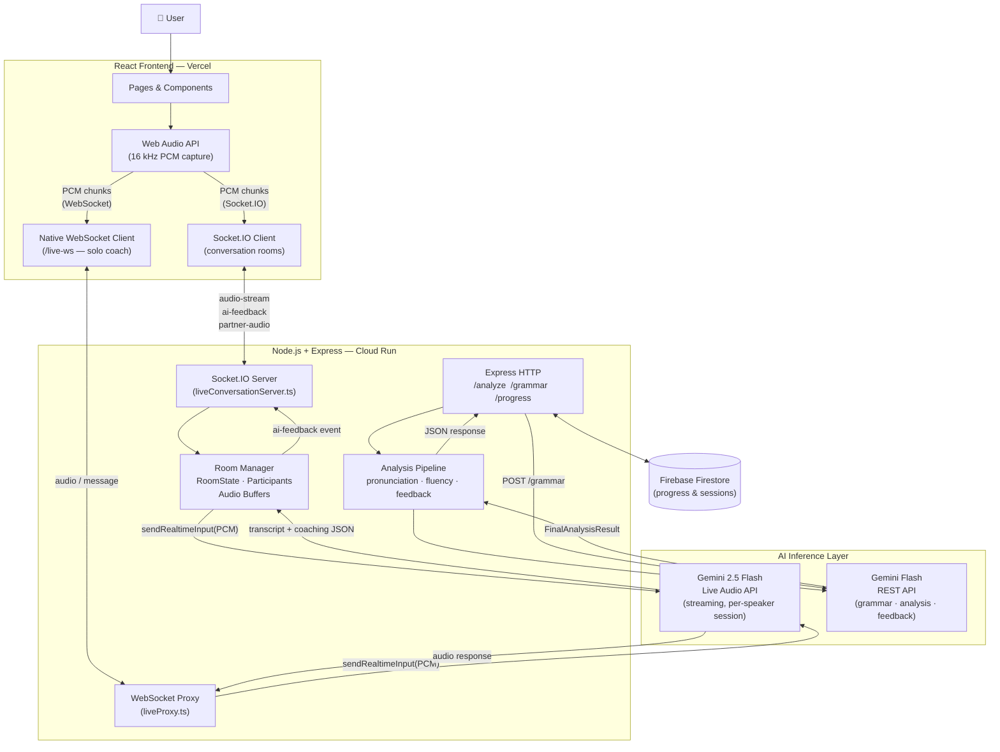

# Sonara — System Architecture

> **Hackathon submission document** — concise, technically precise architecture overview for Devpost judges.

---

## TL;DR (Devpost Summary)

- **Full-stack AI coaching platform** built on React + Vite (frontend) and Node.js + Express (backend)
- **Real-time audio streaming** via Socket.IO — raw PCM chunks sent from browser microphone to server in ~256 ms windows
- **Two Gemini AI pathways**: (1) a persistent Gemini Live Audio session per speaker for instant spoken feedback, (2) Gemini Flash REST calls for grammar correction and pronunciation analysis
- **Multi-user conversation rooms** — two speakers share a Socket.IO room; each gets their own independent Gemini Live session for per-speaker AI coaching
- **Secure by design** — the Gemini API key never reaches the browser; all AI calls are proxied server-side
- **Cloud-native deployment** — backend containerised with Docker and hosted on Google Cloud Run; frontend served on Vercel with edge CDN

---

## Major Architecture Layers

| Layer | Technology | Role |
|-------|-----------|------|
| **Frontend UI** | React 18 + Vite, Zustand, Tailwind CSS | Renders pages, captures microphone audio, plays partner audio, shows AI feedback |
| **WebSocket / Realtime** | Socket.IO (rooms) + native WebSocket (`/live-ws`) | Bidirectional audio transport; room coordination; partner audio relay |
| **Backend Orchestration** | Node.js + Express on a single HTTP server | Routes API requests, manages `RoomState`, bridges frontend ↔ Gemini |
| **AI Inference** | Google Gemini 2.5 Flash Live Audio + Gemini Flash REST | Speech transcription, pronunciation coaching, grammar correction, fluency scoring |
| **Persistence** | Firebase Firestore (optional) | User sessions, accuracy scores, streaks |
| **Infrastructure** | Google Cloud Run (backend) + Vercel (frontend) | Serverless-style containers; auto-scaling; no server management |

---

## High-Level Architecture Diagram



---

## Feature Deep-Dives

### 1 · Live Conversation Rooms

Two users are matched either through a random queue (`join-queue`) or an invite link (`create-invite-room` / `join-room`). Once both are present the server emits `room-ready` and each user can start speaking.

```
User A browser          Backend (liveConversationServer.ts)       User B browser
─────────────          ────────────────────────────────────       ──────────────
startSpeaking()
  → ScriptProcessor
  → pcmFloat32ToBase64()
  → emit('audio-stream', { pcmData, mediaData })
                         ↓
                    audioBufferA.push(pcmChunk)
                    geminiSessionA.sendRealtimeInput(pcm)
                    relay mediaData → emit('partner-audio') ────────────────────→ playback
                         ↓
                    Gemini Live returns JSON:
                    { transcript, correction,
                      pronunciationTip, interruptTip }
                         ↓
                    emit('ai-feedback', feedback) ──────────────────────────────→ feedback UI
  ← emit('ai-feedback') ←
```

**Room State object (per room):**
```
RoomState {
  roomId, createdFrom ('queue' | 'invite')
  userA: Participant { socketId, userId, displayName }
  userB: Participant | null
  geminiSessionA: SpeakerSession | null   ← separate Gemini Live connection
  geminiSessionB: SpeakerSession | null   ← separate Gemini Live connection
  audioBufferA: string[]                  ← base64 PCM chunks
  audioBufferB: string[]
  lastTranscriptA / lastTranscriptB       ← deduplication guard
}
```

---

### 2 · AI Live Coach (Solo Practice)

The `GeminiLiveService` (frontend singleton) opens a native WebSocket to `/live-ws` on the backend. `liveProxy.ts` maps this connection 1-to-1 to a `gemini-2.5-flash-native-audio-latest` Live session. Audio flows in one direction (PCM in, spoken coaching feedback out). The API key is held exclusively in the backend environment.

---

### 3 · Grammar Correction

`POST /grammar` → `grammarAgent.ts` → Gemini Flash (REST).

The agent sends the raw text with a structured prompt requesting:
- grammatical correction
- rule explanation with lesson steps
- IELTS band estimate
- positive/negative example sentences

Response is validated JSON returned to the React `Grammar` page.

---

### 4 · Read-Along Pronunciation Analysis

`POST /analyze` → `runAnalysisPipeline()` orchestrates four agents in series:

```
1. speechProcessor.ts   — tokenise & clean transcript
2. pronunciationAgent.ts — word-level Levenshtein accuracy scoring
3. fluencyAgent.ts      — WPM calculation, pause detection
4. feedbackAgent.ts     — Gemini Flash constructs coaching tips
                        → FinalAnalysisResult { wordScores, accuracyScore,
                                                fluencyScore, wpm, feedback }
```

The pipeline runs on pre-recorded text (not streaming), so it can use the faster REST endpoint instead of the Live API.

---

## Realtime Audio Pipeline

```
[Browser Mic]
    ↓  getUserMedia({ audio: { sampleRate: 16000, channelCount: 1,
                               echoCancellation: true,
                               noiseSuppression: true } })
[AudioContext @ 16 kHz]
    ↓  ScriptProcessorNode (bufferSize = 4096 samples ≈ 256 ms)
    ↓  onaudioprocess callback
        • compute RMS → update waveform visualiser
        • Float32Array → Int16Array (×32768 scale) → ArrayBuffer
        • btoa(binary) → base64 string
[Socket.IO emit 'audio-stream']
    ↓  { pcmData: base64, mediaData: base64_webm }
[liveConversationServer.ts]
    ↓  audioBuffer.push(pcmData)
    ↓  geminiSession.sendRealtimeInput({ audio: { data, mimeType:'audio/pcm;rate=16000' } })
[Gemini Live API]
    ↓  streaming transcript + interruption cues
[Feedback emit 'ai-feedback' / 'ai-tip']
    ↓
[React Rooms.tsx]
    → feedbackItems state → right-side panel
    → liveTip state → overlay tip (auto-dismiss 3.2 s)
```

---

## Deployment Infrastructure

```
┌─────────────────────────────────┐    ┌──────────────────────────────────────────┐
│        Vercel (Frontend)        │    │       Google Cloud Run (Backend)         │
│                                 │    │                                          │
│  • Static React + Vite build    │    │  • Docker container (node:18-alpine)     │
│  • Global CDN edge network      │    │  • Exposes port 8080                     │
│  • Env: VITE_BACKEND_URL        │    │  • GEMINI_API_KEY (Secret Manager)       │
│         VITE_BACKEND_WS_URL     │    │  • FIREBASE_SERVICE_ACCOUNT              │
│                                 │    │  • CORS_ORIGINS = https://…vercel.app    │
│  Zero cold-starts               │    │  • Auto-scales 0→N instances             │
└─────────────────────────────────┘    └──────────────────────────────────────────┘
                │                                         │
                └──────────── HTTPS / WSS ────────────────┘
```

`deploy.sh` builds the Docker image with `gcloud builds submit` and deploys to Cloud Run with a single `gcloud run deploy` call.

---

## Security Notes

| Concern | Mitigation |
|---------|-----------|
| API key exposure | Gemini key lives in Cloud Run env; frontend only talks to `/live-ws` proxy |
| Input abuse | `/analyze` rate-limited (15 req / 60 s per IP); text length capped at 1 000 chars |
| User ID injection | `userId` sanitised to `[a-zA-Z0-9_-]` before Firestore write |
| CORS | Explicit origin allowlist via `CORS_ORIGINS` env var |
| WebSocket hijack | `/live-ws` connections are isolated per connection; no shared state between users |
