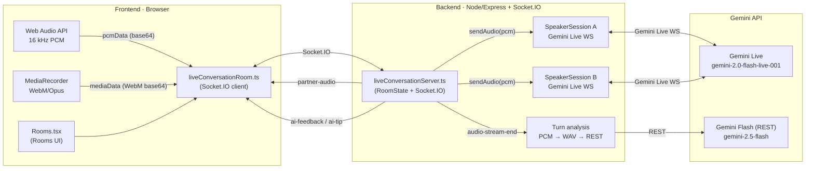
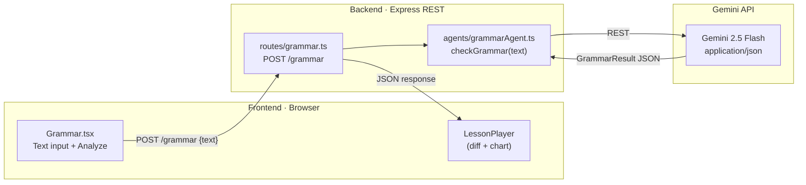
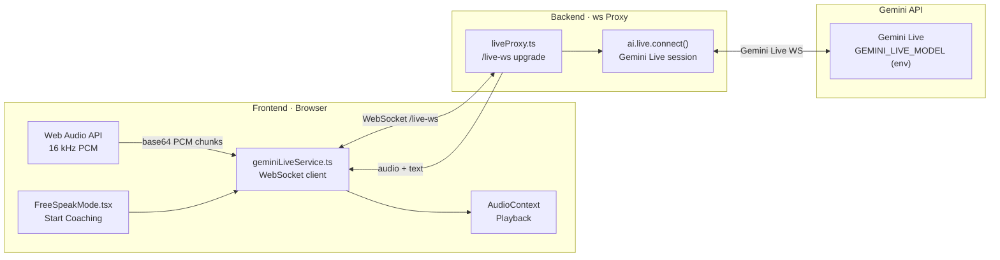

# Sonara — Gemini Connection Diagrams (Room · Grammar · Live AI Coach)

This document provides **Mermaid visual diagrams** that show how each feature connects to Gemini through the frontend and backend layers.

---

## 1) Rooms → Gemini (Socket.IO + Gemini Live)

**Notes**
- Two **independent Gemini Live sessions** (one per speaker) are created per room.
- `audio-stream-end` triggers a **turn analysis** REST call for detailed feedback rows.

---

## 2) Grammar → Gemini (REST + JSON mode)

**Notes**
- Uses **Gemini Flash REST** with `responseMimeType: application/json` to return a structured lesson.

---

## 3) Live AI Coach → Gemini (Native WebSocket + Live Audio)

**Notes**
- The **Gemini API key remains server-side only** inside `liveProxy.ts`.
- Gemini Live returns **audio responses** (plus text transcripts) that are played in the browser.

---

## Security Invariant (All 3 Flows)

The **Gemini API key never reaches the browser**. All Gemini calls are proxied through the backend (`/live-ws` for Live AI Coach, Socket.IO rooms server for Rooms, REST `/grammar` for Grammar).
