```mermaid
flowchart TD
    %% ─────────────────────────────────────────
    %% USER
    %% ─────────────────────────────────────────
    User(["👤 User"])

    %% ─────────────────────────────────────────
    %% FRONTEND (React + Vite · Vercel)
    %% ─────────────────────────────────────────
    subgraph FE["🖥️  Frontend — React / Vite (Vercel)"]
        direction TB

        subgraph Pages["Pages"]
            PracticePage["Practice.tsx\n(Read-Along · Live Coach tabs)"]
            GrammarPage["Grammar.tsx\n(Text input + Lesson Player)"]
            RoomsPage["Rooms.tsx\n(Two-person conversation room)"]
            ProgressPage["ProgressDashboard.tsx\n(Scores · Streaks)"]
        end

        subgraph FE_Services["Frontend Services"]
            PronSvc["pronunciationService.ts\nPOST /analyze"]
            GeminiLiveSvc["geminiLiveService.ts\nWebSocket /live-ws"]
            RoomSvc["liveConversationRoom.ts\nSocket.IO client"]
            ProgressSvc["progressService.ts\nGET /progress · POST /session"]
        end

        subgraph FE_Audio["Audio Layer"]
            WebAudio["Web Audio API\n16 kHz PCM capture\n(ScriptProcessorNode)"]
            MediaRec["MediaRecorder\nWebM / Opus"]
            AudioOut["AudioContext\nAudio playback"]
        end
    end

    %% ─────────────────────────────────────────
    %% BACKEND (Node.js + Express · Cloud Run)
    %% ─────────────────────────────────────────
    subgraph BE["⚙️  Backend — Node.js / Express (Google Cloud Run)"]
        direction TB

        subgraph BE_Routes["Express REST Routes"]
            AnalyzeRoute["routes/analyze.ts\nPOST /analyze\n(rate-limited 15 req/min)"]
            GrammarRoute["routes/grammar.ts\nPOST /grammar"]
            ProgressRoute["routes/progress.ts\nPOST /session · GET /progress"]
        end

        subgraph BE_Pipeline["Analysis Pipeline (pronunciation)"]
            SpeechProc["agents/speechProcessor.ts\nTokenize & clean transcript"]
            PronAgent["agents/pronunciationAgent.ts\nLevenshtein word-accuracy scoring"]
            FluencyAgent["agents/fluencyAgent.ts\nWPM · pace · fluency score"]
            FeedbackAgent["agents/feedbackAgent.ts\n🔗 Gemini Flash REST\n(coaching tips · phonetics · accent)"]
            GeminiRetry["agents/geminiRetry.ts\nRetry helper (429 / quota)"]
        end

        subgraph BE_Grammar["Grammar Agent"]
            GrammarAgent["agents/grammarAgent.ts\n🔗 Gemini Flash REST\n(correction · lesson · IELTS band)"]
        end

        subgraph BE_WS["WebSocket Proxy (/live-ws)"]
            LiveProxy["liveProxy.ts\nUpgrades HTTP → WS\nHolds GEMINI_LIVEVOICE_KEY"]
            LiveProxySession["ai.live.connect()\nGemini Live session\n(one per browser tab)"]
        end

        subgraph BE_Rooms["Conversation Room Server (Socket.IO)"]
            RoomServer["rooms/liveConversationServer.ts\nRoomState · Participants · Audio Buffers"]
            SpeakerA["SpeakerSession A\n🔗 Gemini Live WS\n(per-speaker)"]
            SpeakerB["SpeakerSession B\n🔗 Gemini Live WS\n(per-speaker)"]
            TurnAnalysis["Turn Analysis\nPCM audio → REST\n🔗 Gemini Flash (GEMINI_ANALYSIS_MODEL)"]
        end

        Firebase[("🔥 Firebase Firestore\nsessions · progress docs")]
    end

    %% ─────────────────────────────────────────
    %% GEMINI API (Google AI)
    %% ─────────────────────────────────────────
    subgraph GEMINI["🤖  Google Gemini API"]
        direction TB
        GeminiLive["Gemini Live Audio\ngemini-2.0-flash-live-001\n(GEMINI_ROOM_MODEL env)\n\n• Real-time PCM streaming\n• Returns: transcript JSON\n  + coaching feedback\n  + interrupt cues"]
        GeminiLiveCoach["Gemini Live Audio\n(GEMINI_LIVE_MODEL env)\n\n• Real-time PCM streaming\n• Returns: spoken audio\n  coaching response"]
        GeminiFlash["Gemini 2.5 Flash REST\n(GEMINI_API_KEY /\nGEMINI_FEEDBACK_KEY env)\n\n• Pronunciation feedback\n• Phonetic breakdown\n• Accent influence\n• Grammar correction\n• IELTS band estimate"]
    end

    %% ─────────────────────────────────────────
    %% USER → FRONTEND FLOW
    %% ─────────────────────────────────────────
    User -->|"speaks / types"| Pages

    %% Practice (Read-Along) flow
    PracticePage -->|"text + transcript"| PronSvc
    PronSvc -->|"POST /analyze"| AnalyzeRoute
    AnalyzeRoute --> SpeechProc
    SpeechProc --> PronAgent
    PronAgent --> FluencyAgent
    FluencyAgent --> FeedbackAgent
    FeedbackAgent -->|"generateContent()\napplication/json"| GeminiRetry
    GeminiRetry -->|"REST call"| GeminiFlash
    GeminiFlash -->|"FeedbackResult JSON\n(tips · phonetics · accent)"| FeedbackAgent
    FeedbackAgent -->|"FinalAnalysisResult"| AnalyzeRoute
    AnalyzeRoute -->|"JSON response"| PronSvc
    PronSvc -->|"AnalysisResult"| PracticePage

    %% Practice (Live AI Coach) flow
    PracticePage --> WebAudio
    WebAudio -->|"base64 PCM chunks"| GeminiLiveSvc
    GeminiLiveSvc <-->|"WebSocket /live-ws\naudio · message · status"| LiveProxy
    LiveProxy --> LiveProxySession
    LiveProxySession <-->|"sendRealtimeInput(PCM)\nGemini Live WS"| GeminiLiveCoach
    GeminiLiveCoach -->|"audio response\n(spoken coaching)"| LiveProxySession
    LiveProxySession -->|"type:message payload"| LiveProxy
    LiveProxy -->|"forwarded to client"| GeminiLiveSvc
    GeminiLiveSvc --> AudioOut

    %% Grammar flow
    GrammarPage -->|"POST /grammar {text}"| GrammarRoute
    GrammarRoute --> GrammarAgent
    GrammarAgent -->|"generateContent()\napplication/json"| GeminiFlash
    GeminiFlash -->|"GrammarResult JSON\n(correction · rule · lesson · band)"| GrammarAgent
    GrammarAgent -->|"structured response"| GrammarRoute
    GrammarRoute -->|"JSON"| GrammarPage

    %% Rooms flow
    RoomsPage --> WebAudio
    RoomsPage --> MediaRec
    WebAudio -->|"pcmFloat32ToBase64()\n16 kHz PCM"| RoomSvc
    MediaRec -->|"WebM blob → base64"| RoomSvc
    RoomSvc <-->|"Socket.IO\naudio-stream\nai-feedback\npartner-audio\nai-tip"| RoomServer
    RoomServer -->|"sendAudio(pcm) — User A"| SpeakerA
    RoomServer -->|"sendAudio(pcm) — User B"| SpeakerB
    SpeakerA <-->|"sendRealtimeInput(PCM)\nGemini Live WS"| GeminiLive
    SpeakerB <-->|"sendRealtimeInput(PCM)\nGemini Live WS"| GeminiLive
    GeminiLive -->|"transcript JSON\n+ pronunciationTip\n+ correction\n+ interruptTip"| RoomServer
    RoomServer -->|"audio-stream-end → PCM buffer"| TurnAnalysis
    TurnAnalysis -->|"REST"| GeminiFlash
    GeminiFlash -->|"detailed feedback rows"| TurnAnalysis
    TurnAnalysis -->|"ai-feedback (rows)"| RoomServer
    RoomServer -->|"partner-audio relay"| RoomSvc
    RoomSvc --> AudioOut

    %% Progress / Session flow
    ProgressPage --> ProgressSvc
    ProgressSvc -->|"POST /session"| ProgressRoute
    ProgressSvc -->|"GET /progress"| ProgressRoute
    ProgressRoute <-->|"Firestore read/write"| Firebase

    %% ─────────────────────────────────────────
    %% ENV KEY LEGEND (no key reaches browser)
    %% ─────────────────────────────────────────
    classDef geminiNode fill:#4285F4,color:#fff,stroke:#1a73e8,stroke-width:2px
    classDef backendNode fill:#34A853,color:#fff,stroke:#1e8e3e,stroke-width:1px
    classDef frontendNode fill:#FBBC04,color:#000,stroke:#f09300,stroke-width:1px
    classDef firebaseNode fill:#FF6D00,color:#fff,stroke:#e65100,stroke-width:2px
    classDef userNode fill:#EA4335,color:#fff,stroke:#c5221f,stroke-width:2px

    class GeminiLive,GeminiLiveCoach,GeminiFlash geminiNode
    class AnalyzeRoute,GrammarRoute,ProgressRoute,SpeechProc,PronAgent,FluencyAgent,FeedbackAgent,GeminiRetry,GrammarAgent,LiveProxy,LiveProxySession,RoomServer,SpeakerA,SpeakerB,TurnAnalysis backendNode
    class PracticePage,GrammarPage,RoomsPage,ProgressPage,PronSvc,GeminiLiveSvc,RoomSvc,ProgressSvc,WebAudio,MediaRec,AudioOut frontendNode
    class Firebase firebaseNode
    class User userNode
```

# Sonara — Full Gemini Connection Diagram

This document shows **every connection between Gemini and Sonara** — from browser microphone to AI model and back — across all four major features.

---

---

## Gemini API Key Mapping

| Environment Variable | Used By | Gemini Feature |
|---|---|---|
| `GEMINI_LIVEVOICE_KEY` (falls back to `GEMINI_API_KEY`) | `liveProxy.ts` | Live AI Coach — solo pronunciation coaching via WebSocket `/live-ws` |
| `GEMINI_ROOM_MODEL` (env sets model; key via `GEMINI_API_KEY`) | `liveConversationServer.ts` | Conversation Rooms — per-speaker Gemini Live sessions |
| `GEMINI_ANALYSIS_MODEL` (env sets model) | `liveConversationServer.ts` — turn analysis | Conversation Rooms — post-turn detailed feedback rows |
| `GEMINI_FEEDBACK_KEY` (falls back to `GEMINI_API_KEY`) | `feedbackAgent.ts` | Read-Along — pronunciation coaching tips & phonetic breakdown |
| `GEMINI_API_KEY` | `feedbackAgent.ts` (library practice) | Read-Along — library passage pronunciation analysis |
| `GEMINI_FEEDBACK_KEY` / `GEMINI_API_KEY` | `grammarAgent.ts` | Grammar Checker — correction, rule, lesson steps, IELTS band |

> **Security invariant:** No Gemini API key ever reaches the browser. All model calls are made server-side inside the Node.js backend running on Google Cloud Run.

---

## Gemini Connection Summary

| Feature | Page | Frontend Service | Backend Handler | Gemini API |
|---|---|---|---|---|
| **Read-Along Pronunciation** | `Practice.tsx` | `pronunciationService.ts` | `routes/analyze.ts` → `analysisPipeline.ts` → `feedbackAgent.ts` | Gemini Flash REST (`gemini-2.5-flash`) |
| **Live AI Coach** | `Practice.tsx` → `FreeSpeakMode.tsx` | `geminiLiveService.ts` (WebSocket) | `liveProxy.ts` (WS proxy) | Gemini Live Audio (`GEMINI_LIVE_MODEL`) |
| **Grammar Checker** | `Grammar.tsx` | direct `fetch` → `/grammar` | `routes/grammar.ts` → `grammarAgent.ts` | Gemini Flash REST (`gemini-2.5-flash`) |
| **Conversation Rooms** | `Rooms.tsx` | `liveConversationRoom.ts` (Socket.IO) | `liveConversationServer.ts` → `SpeakerSession A/B` | Gemini Live Audio (`gemini-2.0-flash-live-001`) |
| **Rooms Turn Analysis** | `Rooms.tsx` | `liveConversationRoom.ts` (Socket.IO) | `liveConversationServer.ts` → turn analysis | Gemini Flash REST (`GEMINI_ANALYSIS_MODEL`) |
